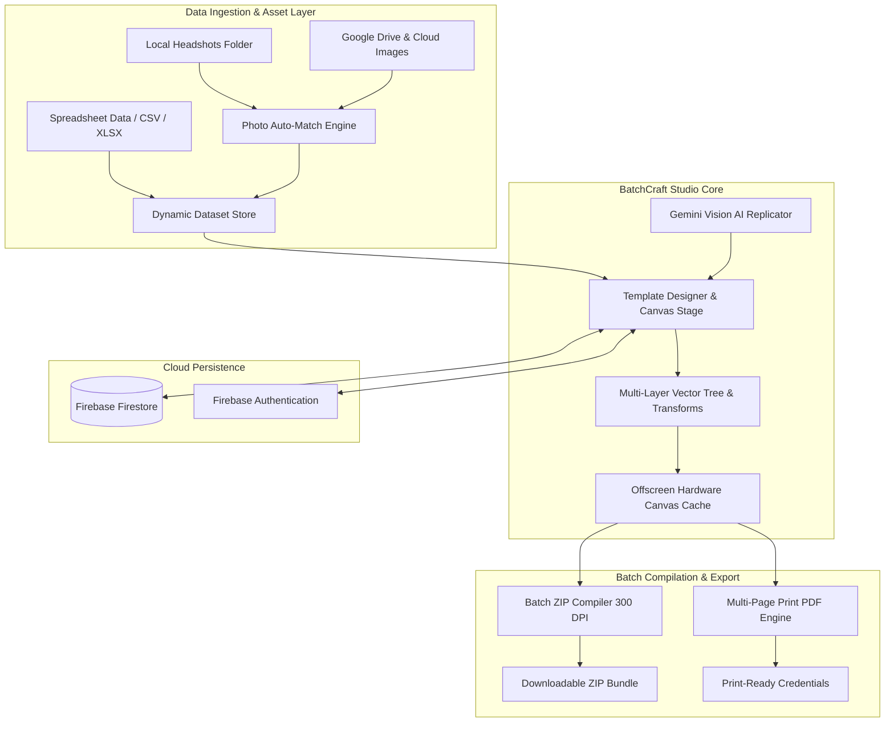

# 🏷️ BatchCraft Studio

<div align="center">

[](https://batchcraft-studio.firebaseapp.com)
[](https://batchcraft-studio.firebaseapp.com)
[](https://github.com/matthewobanla/BatchCraft)
[](https://www.typescriptlang.org/)
[](https://react.dev/)
[](https://tailwindcss.com/)

**Professional Automated Bulk Printing, Canvas Studio & Variable Data Design Engine**

*Design a master template once, connect your spreadsheet dataset, auto-match recipient photo directories, and mass-generate thousands of personalized badges, certificates, ID cards, dynamic QR codes, and custom credentials at scale.*

[Live Production App](https://batchcraft-studio.firebaseapp.com) • [Source Code Repository](https://github.com/matthewobanla/BatchCraft) • [Key Features](#-key-features) • [System Architecture](#-system-architecture) • [Tech Stack](#-tech-stack--engineering)

---

</div>

## 📌 Project Overview

**BatchCraft Studio** is a browser-native vector design studio and bulk variable-data printing engine built to replace tedious, manual badge/card generation workflows.

Traditional graphic design tools collapse when tasked with merging dynamic spreadsheets with precision multi-layer vector designs. BatchCraft Studio bridges this gap by combining the intuitive flexibility of modern canvas editors with the computational power of a client-side batch compiler, bi-directional automated photo-matching, AI layout replication, and real-time cloud persistence.

---

## 🌐 Live Production Application

- **Primary Production URL**: [https://batchcraft-studio.firebaseapp.com](https://batchcraft-studio.firebaseapp.com)
- **Web App Mirror**: [https://batchcraft-studio.web.app](https://batchcraft-studio.web.app)
- **Core Repository**: [https://github.com/matthewobanla/BatchCraft](https://github.com/matthewobanla/BatchCraft)

---

## 🚀 Key Features

### 🎨 1. Interactive Multi-Layer Canvas Engine
- **Vector & Layer Hierarchy:** Seamlessly stack, reorder, group, and style text, photos, QR codes, 1D barcodes, geometric shapes, lines, and SVG icons.
- **Precision Transformations:** Custom sub-pixel snapping, magnetic guidelines, bounding boxes, multi-point resizing handles, and rotation pivots.
- **Dynamic Typography:** Custom font pairing engine, line-height calibration, letter tracking, alignment controls, and integrated Google Fonts.
- **Zero-Latency 60 FPS Performance:** Offscreen canvas rasterization and memoized layer reconciliation eliminate UI lag when scaling, zooming, or switching between hundreds of badge rows.

### 👥 2. Intelligent Headshot & Photo Auto-Matching
- **Bi-Directional Automated Matching:** Upload a folder of headshots or link Google Drive images, and BatchCraft immediately pairs each photo with its corresponding badge recipient using fuzzy multi-field scoring (matching across recipient names, email addresses, and identification numbers).
- **Manual Overrides & Unlink Protection:** Explicitly unlink or reassign any image per badge card. Persistent state tracking guarantees manual adjustments are never inadvertently overwritten by automated matching loops.
- **Dedicated Media Library:** Consolidated right-panel photo library with thumbnail previews, dimension indicators, and instant single-click layer assignments.

### 📊 3. Dynamic Variable Data & Spreadsheet Compiler
- **Mustache Syntax Mapping:** Bind elements to dynamic CSV/Excel columns using standard tokens (e.g., `{{FullName}}`, `{{Role}}`, `{{TicketID}}`, `{{Department}}`).
- **Bulk Photo Mapping:** Map cloud image URLs or local photo directories directly into individual card layers.
- **Dynamic QR & Barcodes:** Generate crisp vector QR codes (with custom color palettes, error correction levels, and margins) and 1D barcodes on the fly for every single row.

### 🤖 4. AI Design Replicator (Gemini Vision)
- **Instant Template Deconstruction:** Drop or paste a screenshot of any physical badge, certificate, or digital template.
- **Automated Blueprint Generation:** Multimodal AI analyzes element positions, font styles, colors, and layout hierarchies, instantly reconstructing the design as editable studio layers.

### ⚡ 5. High-Throughput Batch Output Engine
- **Client-Side ZIP Archiving:** Multi-threaded asynchronous rendering generates and packages hundreds of print-ready 300 DPI badge images into a single ZIP archive in seconds.
- **Print-Ready PDF Exports:** Precision multi-card pagination, CMYK-safe rendering, and vector fidelity for commercial print shops.

### ☁️ 6. Cloud Ecosystem & Firebase Persistence
- **Optimistic Auto-Save Queue:** Real-time debounced background synchronization with visual sync indicators.
- **Firebase Firestore & Auth:** Multi-project management with Google OAuth and email authentication secured by robust Firestore security rules.

---

## 🛠️ System Architecture



---

## 💻 Tech Stack & Engineering

| Layer | Technologies Used |
| :--- | :--- |
| **Frontend Framework** | React 19 (TypeScript), Vite 6, Tailwind CSS |
| **Rendering Engine** | HTML5 Canvas 2D API, Custom Matrix Transformation Engine, Offscreen Buffering |
| **Artificial Intelligence** | Google Gemini Vision API (`@google/genai`) |
| **Cloud & Database** | Firebase Authentication, Google Cloud Firestore, Firebase Hosting |
| **Export & Processing** | JSZip, Canvas-to-Blob, PDF rendering, FileSaver |
| **Icons & Design System** | Lucide React, Custom Figma-Style Micro-UI |

---

## 🚀 Quick Start & Local Setup

```bash
# 1. Clone the repository
git clone https://github.com/matthewobanla/BatchCraft.git
cd BatchCraft

# 2. Install dependencies
npm install

# 3. Launch the development server
npm run dev

# 4. Open in browser
http://localhost:3000
```

---

## ☁️ Deployment

```bash
# Build production bundle
npm run build

# Deploy to Firebase Hosting
firebase deploy --only hosting
```

Target Firebase Project:
- **Project ID**: `batchcraft-studio`
- **Domain**: [https://batchcraft-studio.firebaseapp.com](https://batchcraft-studio.firebaseapp.com)

---

<div align="center">

Designed and engineered by **[Matthew Obanla](https://github.com/matthewobanla)**

</div>
